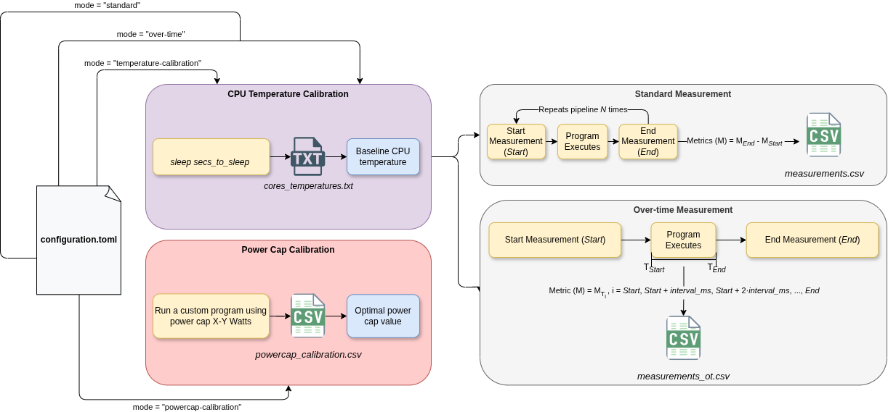
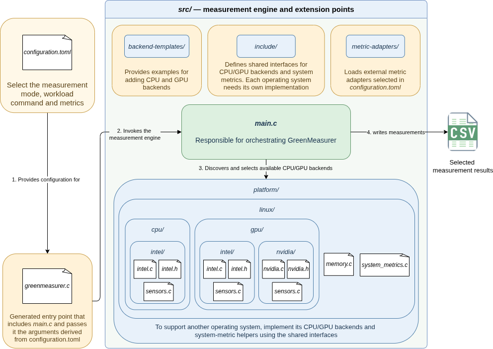

# GreenMeasurer: An Extensible Linux Framework for Software Energy Measurement

GreenMeasurer is a modular framework for measuring software energy consumption, power-cap behavior, and execution telemetry on Linux. Its CPU and GPU backend interfaces are designed to make additional hardware implementations possible without adding vendor-specific logic to the measurement engine.

The C measurement engine coordinates platform-specific telemetry plugins through shared interfaces. It records hardware-domain energy (joules), execution time, memory use, temperatures, and other selected metrics as CSV data. Linux is the currently implemented platform; other operating systems would require their own platform-specific implementations.

| Authors      | Contacts                 |
|:------------:|:------------------------:|
| Simão Cunha  | simao.s.cunha@inesctec.pt |
| João Saraiva | saraiva@di.uminho.pt     |

---

> The research-paper-style documentation follows the section structure of `GreenMeasurer.pdf`: [docs/PAPER_DRAFT.md](docs/PAPER_DRAFT.md). For a supplementary implementation overview, see [docs/ARCHITECTURE.md](docs/ARCHITECTURE.md).

## Architecture & Directory Layout

### Measurement workflow

The workflow covers temperature and power-cap calibration, standard
measurements, and over-time sampling.



### Framework structure and extension points

The framework separates measurement orchestration from CPU/GPU backends and
external metric adapters.



The editable diagrams are available in [docs/](docs/).

The project isolates platform access from measurement orchestration. In the current Linux implementation, platform-specific code resides under this hierarchy:

```text
src/
├── include/
│   ├── energy-backend.h                # HAL definition for CPU & GPU energy backends
│   ├── metric-adapter.h                # External gauge adapter interface
│   ├── system_metrics.h                # Shared system-metrics interface
│   └── sensors.h                       # Shared declarations for sensor helpers
├── platform/
│   └── linux/
│       ├── memory.c                   # Linux workload peak RSS via wait4()
│       ├── system_metrics.c            # Linux system/process metrics (/proc, /sys)
│       ├── cpu/
│       │   └── intel/
│       │       ├── intel.c             # Intel RAPL MSR telemetry & raplcap powercapping
│       │       ├── intel.h             # Intel MSR addresses & model declarations
│       │       └── sensors.c           # coretemp sensor driver & package temperature
│       └── gpu/
│           ├── intel/
│           │   ├── intel.c             # Intel integrated GPU backend
│           │   ├── intel.h             # Backend and sensor declarations
│           │   └── sensors.c           # GPU hwmon temperature reader
│           └── nvidia/                 # NVIDIA NVML backend
├── metric_adapters/
│   └── metric_adapter_loader.c         # External gauge adapter loader
├── launcher.c                          # TOML generator launcher
├── main.c                              # Measurement engine included in generated C
├── overtime.inc # Sequential over-time sampler
└── Makefile                            # Builds backends whose Linux dependencies are available
```

---

## Supported Hardware & Features

| Platform Target | Energy Telemetry | Power Capping | Thermal Sensors | Driver / Mechanism |
|---|---|---|---|---|
| **Intel CPU** | Package, Core, DRAM (when exposed) | Supported (`raplcap` / `powercap`) | Core average | Model-Specific Registers (`/dev/cpu/%d/msr`) |
| **Intel integrated GPU** | GPU domain (when exposed) | Not provided by GPU backend | GPU temperature (when exposed) | RAPL PP1 and hwmon |
| **NVIDIA GPU** | Dedicated GPU domain | Not provided by GPU backend | Core junction | NVML (`libnvidia-ml`) |

> **Note on CSV Semantics:** An inactive backend contributes no columns. Configured metrics that can be checked before the workload are skipped when their preflight read fails. Later failed reads are recorded as `NOT_SUPPORTED`, with a warning.

---

## System Requirements & Prerequisites

### 1. Operating System & Kernel
* Linux Kernel 4.x or later.
* Access to kernel MSRs:
  ```bash
  sudo modprobe msr
  ```

### 2. Dependencies
* `build-essential` (`gcc`, `make`)
* `lm-sensors`
* `libpowercap` and `raplcap` headers and libraries, plus `libsensors` development headers and library (required to build the Intel CPU backend)
* NVML headers and `libnvidia-ml` (required to build the NVIDIA GPU backend)

On Ubuntu/Debian:
```bash
sudo apt-get update
sudo apt-get install -y build-essential lm-sensors libsensors-dev libpowercap-dev libraplcap-dev
```

---

## Building the Framework

The `Makefile` checks the machine's CPU and PCI display devices before building
the corresponding backend plugins. It also skips plugins whose required headers
or libraries are unavailable. The built-in checks recognize Intel CPUs and Intel
and NVIDIA GPUs; a failed hardware check is reported and the affected backend is
skipped. Plugins still check hardware at runtime before selection.

```bash
# Compile the core and backends for detected hardware with available dependencies
make -C src
```

For example, the Intel CPU backend is skipped if an Intel CPU is not detected or
the powercap, raplcap or libsensors development files are absent. The NVIDIA
backend also requires a detected NVIDIA display device, the NVML header and
library. Use `make -C src VERBOSE=1` to see skipped backend reasons. Previously
built plugins are not deleted when hardware changes; runtime detection still
prevents incompatible plugins from being selected.

---

## TOML configuration and execution

GreenMeasurer requires a TOML file. Set `measurement.mode` to `standard`
for repeated aggregate measurements or `over-time` for interval sampling, and
select the metrics in `[metrics]`. Generate and compile first, then execute
the generated binary separately:

```bash
make -C src
./src/main --directory generated
sudo ./generated/greenmeasurer
```

By default the launcher uses the repository-root `configuration.toml`; edit it
to choose the workload, mode and metrics. Use `--config path/to/file.toml`
before `--directory` to select a different configuration.
Alternatively invoke `python3 scripts/generate_config.py FILE --directory DIR`.
The output directory must not already exist. The executable embeds the
configuration, accepts no overrides, and does not reread the TOML. Rebuild it
when the configuration changes. The old measurement CLI is no longer available.

### Hardware test configurations

The TOML files in [`configurations/`](configurations/) are split in three folders:

| Folder | Contents |
|--------|----------|
| [`selected-some-metrics/`](configurations/selected-some-metrics/) | Temperature and powercap calibration, plus standard and over-time measurements, each selecting a few metrics |
| [`all-metrics/`](configurations/all-metrics/) | Standard and over-time runs with `select = "all"` |
| [`new-metrics/`](configurations/new-metrics/) | Standard and over-time runs that add system uptime, a metric GreenMeasurer does not provide, from [`system_uptime.c`](configurations/new-metrics/system_uptime.c) and [`system_uptime.h`](configurations/new-metrics/system_uptime.h) |

The paper example set is maintained separately in
[`paper_data/`](paper_data/): it contains standard and
over-time runs with and without a 5 W cap, both calibration configurations,
and uses `select = "all"`. See [`paper_data/README.md`](paper_data/README.md)
for the run parameters and repetition details.

The hardware test configurations use the same short CPU-bound Python workload
and do not depend on the `Languages` directory. Run commands
from the repository root so that the shared temperature baseline and CSV files
are written there. For each configuration, generate into a new directory:

```bash
./src/main --config configurations/selected-some-metrics/temperature.toml
./src/main --config configurations/selected-some-metrics/standard.toml --directory generated-standard-test
sudo ./generated-standard-test/greenmeasurer
```

Replace the configuration and generated directory names to run the other files.

When run with `sudo`, output files (CSVs and calibration files) are made world-readable and, if `SUDO_UID`/`SUDO_GID` are set, owned by the invoking user, so no `sudo` is needed to open them.
The output CSV is overwritten on a successful run. Access to Intel RAPL MSRs and
powercap controls may require elevated privileges.

**Powercap tests change real hardware settings.** Check the host's supported
limits and adjust `powercap`, `powercap_min` and `powercap_max` before running;
example watt values are not guaranteed to be supported or applied exactly.
The Intel backend provides powercap callbacks for standard, over-time and
calibration measurements. It saves the machine's package limits and zone state
in `/var/lib/greenmeasurer/intel-rapl-baseline` on first use, then restores
those values after each measurement. A `-1` measurement applies that saved
baseline. The first capture assumes the current hardware settings are the
desired baseline, so establish them first (for example, reboot after an older
run left a cap active). To capture a new baseline, stop GreenMeasurer, remove
the saved baseline file, and run a measurement with `powercap = -1`. Restoration
has not been verified on all hardware; check package settings before and after
each run. Firmware and other power-limit interfaces may also apply limits.
The backend preserves time windows rather than rewriting them: on some Linux
drivers, writing back a window can change its value through quantization. If a
current window differs from the saved baseline, the measurement stops and
reports both values; restore the window externally or establish and capture a
new baseline before retrying.

### Over-time sampling
The parent process samples the backends and system metrics sequentially while the
workload runs, without sampler threads. Samples are stored in static arrays and
the CSV is written after the workload exits. The default pause between sampling
cycles is 1 ms; the time spent reading metrics and scheduler delays make the
actual intervals longer and variable. This is a polling interval, not a
hardware update notification: repeated counter readings or missed updates are
possible. A final partial interval is recorded when the workload exits.

Over-time sampling stores up to 1000000 rows in static arrays by default. The
array size is a compile-time flag: build with `make -C src OT_MAX_SAMPLES=<rows>`
(or `-DOT_MAX_SAMPLES=<rows>`) to choose a different capacity. The default
reserves about 1.9 GiB of virtual address space on a 64-bit system; resident
memory depends on which metrics are collected. At exactly 1000 samples per
second, the default covers approximately 16 minutes and 40 seconds. If the
capacity is exceeded, the workload is stopped and the measurement fails without
writing a partial CSV. Over-time sampling supports up to 30
external metrics; exceeding that limit fails before the workload starts. Metric
collection itself may perform I/O and, depending on the backend, allocate memory.

For scripts to analyze observed sample intervals, probe RAPL update behavior,
and compare workload timing overhead, see [scripts/README.md](scripts/README.md#evaluating-over-time-sampling).

### Calibration

Calibration also requires TOML. Use `mode = "temperature-calibration"` with
`sleep_seconds` and `calibration_file`, or `mode = "powercap-calibration"`
with `command`, `powercap_min`, `powercap_max` and optional `compile_command`,
`language`, `program`, `output`, `repetitions`, `timeout_hours`, `variance`,
`sleep_seconds` and `calibration_file`. Temperature calibration does not use a
`[metrics]` table; powercap calibration accepts an optional one.

The [website](website/index.html) provides a configuration and execution guide.

For example:

```bash
python3 scripts/generate_config.py src/tests/fixtures/configurations/temperature-calibration.toml --directory generated-temperature
./generated-temperature/greenmeasurer
python3 scripts/generate_config.py src/tests/fixtures/configurations/powercap-calibration.toml --directory generated-powercap
sudo ./generated-powercap/greenmeasurer
```

Powercap calibration runs tests at each Watt step in the configured range. It
requires a backend supporting calibration and appropriate hardware permissions.
When a CPU backend is active, every measurement and calibration requires a
readable CPU temperature from it. If it is unavailable, the program reports an
error and does not start the workload. If no CPU backend is active but a GPU
backend is (for example an unsupported CPU with an NVIDIA GPU), the temperature
check, baseline waiting and temperature calibration are skipped; `variance` and
`sleep_seconds` then have no effect, and only `gpu.*` and `system.*` metrics are
available.
The Intel backend first applies the saved per-machine baseline for
`Powercap = -1`, then measures each configured limit. Results are summarized if
post-processing is available. The first run captures the current system limits;
ensure they are the desired baseline before that capture.

On Intel, each requested Watt value in the calibration is applied to every
package and its dies. Before applying a cap, the backend saves each package
zone's limits and enabled state, then restores them after the measurement.
Firmware or other power limits can still apply. The saved baseline survives
process termination, so a later `powercap = -1` measurement reapplies it.
`powercap` accepts one value or a list (for example `powercap = [-1, 5, 10]`);
each value is measured in turn and written to the same CSV with a `Powercap`
column. Each applied cap is restored to the limits and enabled state that were
present immediately before that cap was applied.
`temperature-calibration` needs no `--directory`: `./src/main --config <file>`
writes the `.txt` directly. `powercap-calibration` accepts an optional
`[metrics]` section (selected, `select = "all"` or `[[external_metrics]]`;
default `cpu.Package`) and sweeps `-1, powercap_min..powercap_max`.

Intel powercapping sets the same wattage for both package limits while
preserving their baseline time windows. It saves and restores state separately
for every package and die, including when a measurement fails. The baseline
file is local to the machine and is not overwritten on later runs; if the
machine's desired baseline changes, remove the file while no measurement is
running and capture the new baseline with `powercap = -1`.

In standard mode, `cpu.Package_J` is total package energy over the run, not average power. A lower power cap can extend `Time_ms` enough that total energy stays similar or increases; compare both metrics, or derive average package power as `cpu.Package_J / (Time_ms / 1000)`. Do not assume package energy must decrease monotonically with the cap.

### Batch measurements

Supply one TOML file per workload and generate the batch before executing it:

```bash
bash scripts/measure.sh generate generated-batch first.toml second.toml
bash scripts/measure.sh run generated-batch
```

Each configuration determines its own mode, command, metrics and output path.
Use distinct output files to avoid overwriting earlier results. The script does
not compile workloads, change network settings, or delete existing CSV files.
The Fibonacci Makefiles also expose `generate CONFIG=... BUILD_DIR=...` and
`run-configured BUILD_DIR=...` targets, invoked from the workload directory.

---

## Output CSV Schemas

The CSV schema is generated at runtime from the configured, available metrics.
The framework metadata columns are followed by columns for the selected system,
backend and external metrics. Backend metric columns use the form
`<category>.<metric-name>_<unit>`; therefore the exact schema varies by machine.
Only selected and available metrics contribute columns.

For example, standard mode on a system with Intel CPU and NVIDIA GPU backends may
produce:

```csv
Language,Program,Powercap,Time_ms,CPU_Memory_KB,Cores,Workload_Processes_Peak,System_Running_Processes_Peak,Core0_Avg_Freq_MHz,...,cpu.Package_J,cpu.Core_J,cpu.DRAM_J,cpu.Temperature_C,gpu.GPU_J,gpu.Power_W,gpu.Temperature_C,gpu.Utilization_%,gpu.VRAM_MiB
```

`Language`, `Program`, and `Powercap` describe the run. `Time_ms` is elapsed
wall-clock time in milliseconds, and `CPU_Memory_KB` is maximum RSS in KiB reported by
`wait4()`/`ru_maxrss` for the measured execution. It is not the sum of simultaneous
RSS across the process tree. Backend metric values use the unit in the
column name. `Cores` is the number of online logical cores, `Workload_Processes_Peak` and
`System_Running_Processes_Peak` are the maxima seen during the run, and `Core<N>_Avg_Freq_MHz` is each
core's mean frequency over the run (all sampled every 50 ms). A metric without a supported reading is written as `NOT_SUPPORTED`.

Metric behavior is declared by each backend:

* **Window metrics** are measured between `sample_start` and `sample_stop`.
* **Gauge metrics** are read at the end of a standard run, except CPU
  temperature, which is recorded immediately before the workload after the
  thermal gate passes. Over-time sampling continues to collect temperature during execution.
* **Peak metrics** are polled during standard runs; process-scoped metrics are
  aggregated across the workload process tree. Polling is every 50 ms, so brief
  allocations may be missed.

In over-time mode `Timestamp_ms` is the monotonic elapsed time in milliseconds
(with sub-millisecond decimals)
at the start of each sample's backend readings, and
`CPU_Memory_KB` is the current resident set size of the workload process tree.
It also reports `Cores` (online logical cores), `Workload_Processes` (live
processes in the workload tree), `System_Running_Processes` (runnable processes
system-wide) and one `Core<N>_Freq_MHz` column per core. Each of the memory, core-count, process-count, running-process and core-frequency
metrics is read sequentially in each cycle. Values in the same row are therefore
not exactly simultaneous. Process-scoped readings may be unavailable in the
final row because the workload has already exited. For example:

```csv
Language,Program,Powercap,Timestamp_ms,CPU_Memory_KB,Cores,Workload_Processes,System_Running_Processes,Core0_Freq_MHz,...,cpu.Package_J,cpu.Core_J,cpu.DRAM_J,cpu.Temperature_C,gpu.GPU_J,gpu.Power_W,gpu.Temperature_C,gpu.Utilization_%,gpu.VRAM_MiB
```

Over-time energy columns contain counter snapshots converted to joules, not
energy consumed during the interval. Their starting point depends on the
hardware, and Intel RAPL counters can wrap. A plugin that cannot expose a
counter snapshot through `energy_backend_read_counter` reports `NOT_SUPPORTED`
with a warning. Gauges and process-scoped values are readings taken in that
cycle. The timestamp is taken immediately before the sequential backend reads,
so the timing of individual metrics is approximate.
Standard mode continues to accumulate 50 ms segments. The generated CSV header
reflects the selected metrics that are available at runtime.

---

## Adding a New Architecture / Driver

An experimental interface for additional, independent gauge metrics is defined
in [`src/include/metric-adapter.h`](src/include/metric-adapter.h), with a
loader in [`src/metric_adapters/metric_adapter_loader.c`](src/metric_adapters/metric_adapter_loader.c)
and an example in [`src/tests/fixtures/custom_metric/`](src/tests/fixtures/custom_metric/). The
adapter exports a versioned descriptor with names and units, optional
initialization and cleanup, and a read callback that returns a status and writes
a finite numeric value. For example, the provided adapter wraps a C library
that reads the number of runnable Linux processes. Build it with
`make -C src/tests/fixtures/custom_metric`. Only load trusted adapters: loading a shared
library executes native code within the GreenMeasurer process.

Every metric needs an implementation that obtains its value. Backend metrics
are routed through the backend's `get_metric` callback; external metrics are
routed by index through the adapter's `read` callback. The callback must map
each advertised name to the corresponding library function. A TOML name alone
does not create that function, and GreenMeasurer cannot verify that an adapter
implemented the intended calculation.

To add an external gauge from a trusted C library, use
[`src/tests/fixtures/custom_metric/adapter.c`](src/tests/fixtures/custom_metric/adapter.c) as a
template: include the library's `.h`, add the metric name and unit to the
adapter descriptor, and call the library function from `read` for that metric's
index. Compile the adapter together with the library's `.c` file into a shared
library, as shown by [`src/tests/fixtures/custom_metric/Makefile`](src/tests/fixtures/custom_metric/Makefile).
Then declare its path under `[[adapters]]` and select
`external.<adapter>.<metric>` in TOML. `make -C src/tests/fixtures/custom_metric` builds a
working example. Adapters currently support gauges only; CPU/GPU metrics needing
hardware-specific window or process semantics require a backend instead.

For an unknown configured metric the diagnostic explains how to add a library
adapter. When a registered metric fails to read, the message instead says the
read failed and suggests checking hardware, permissions and the implementation:
failure alone does not establish that the metric or its function is missing.

A TOML configuration can be validated with
`python3 scripts/validate_config.py src/tests/fixtures/configuration.toml`; Python 3.11+
or the `tomli` package is required. The validator checks syntax and structure,
not hardware availability, and does not execute measurements. This particular
file selects CPU metrics whose availability depends on the selected backend
and hardware.

Measurement configurations require `[measurement]` with `mode = "standard"` or
`"over-time"`, and `[metrics]` with `select = "all"` or a non-empty list of metric
references. References use `cpu.<name>`, `gpu.<name>`,
`external.<adapter>.<name>`, or one of `system.memory`, `system.cores`,
`system.workload_processes`, `system.running_processes`, and
`system.core_frequency`. Backend and adapter metric names are not verified
against the actual libraries by the validator.

Generation requires `command`. Optional measurement fields are `language`, `program`, `output`,
`calibration_file`, `powercap`, `variance`, and `sleep_seconds`. Additionally,
`interval_ms` is specific to over-time sampling, while `repetitions` and `timeout_hours`
are specific to standard mode. A power cap must be `-1` or positive.

External metrics refer to named adapter tables. For example, after building the
example adapter, an executable configuration file in the repository root could
contain:

```toml
[measurement]
mode = "over-time"
command = "sleep 1"
sleep_seconds = 0

[metrics]
select = ["external.processes.RunningProcesses"]

[[adapters]]
name = "processes"
path = "src/tests/fixtures/custom_metric/adapter.so"
```

Adapter paths are resolved relative to the configuration file and must already
exist when validating. Validation does not load them or verify their ABI.

To also check the selected external metrics, build the checker and opt in to
loading the adapters:

```bash
make -C src metric-adapter-check
make -C src/tests/fixtures/custom_metric
python3 scripts/validate_config.py --check-adapters src/tests/fixtures/custom_metric/configuration.toml
```

Replace the example path with your own configuration when testing another
adapter:

```bash
python3 scripts/validate_config.py --check-adapters path/to/config.toml
```

This executes native code from the configured libraries, including their
initialization, read and cleanup callbacks. Only use it with trusted adapters.
Explicitly selected external metrics must exist and return finite values;
with `select = "all"`, failed reads are reported and skipped. This is a
point-in-time check: later reads may still fail. It does not check CPU, GPU or
system metrics or execute the workload.

### Executing a configuration

The generator can also build one shared adapter per selected external function
directly from C sources. For example:

```bash
python3 scripts/generate_config.py src/tests/fixtures/configurations/external-source.toml \
  --directory generated-external
./generated-external/greenmeasurer
```

In `[[external_metrics]]`, `name`, `metric` and `unit` define the CSV metric,
while `header`, `sources`, `function` and `return_type` specify its C
implementation. Paths are relative to the TOML file. Supported return and
argument types are `int`, `unsigned int`, `float` and `double`; `arguments` is an array
of inline tables such as `{type = "int", value = 3}`. `include_dirs` and
`libraries` are optional arrays, with library names specified without `-l`.
An optional `error_value` identifies a numeric failure result; non-finite
values always fail. The compiler checks the exact declared function signature
and links the sources with undefined symbols disallowed. If compilation fails,
the metric is skipped with compiler diagnostics and possible name suggestions;
generation fails if no selected metrics remain. Suggestions are never called
automatically. These are native libraries: use only trusted source code.

An unrecognized return or argument type defaults to `double` with a warning;
the resulting signature must still match the function's header. Generated
metrics retain their declared numeric type for reading and storage. CSV stores
text, not types: integers are written as integers, while floating-point values
use decimal or scientific notation (for example, `1.0`). Existing custom
adapters remain compatible and continue to return `double` through the
original interface. The generated adapters also provide that interface for
compatibility with existing adapter tools.

Each `[[external_metrics]]` table produces its own `.so`, even when multiple
metrics use the same source files. Select an external metric using either its
short name, such as `external.processes.RunningProcesses`, or its function
name, `external.processes.get_number_of_running_processes`. Both refer to the
same metric and cannot be selected together. The CSV column always uses the
short name. Built-in CPU/GPU metrics remain in their backend's shared library
and do not need a separate library per metric.

External metrics whose adapters cannot be loaded or do not declare the metric,
and external and device-scoped backend metrics that cannot be read during
preflight, are skipped with diagnostics. Once a measurement starts, failed external reads produce
`NOT_SUPPORTED` in the corresponding CSV cell with a warning. Backend read
failures during measurement are also marked `NOT_SUPPORTED`. If a backend's
sampling window fails, its columns remain unavailable for the rest of the
measurement; standard mode does not report a partial energy sum as complete.
System core count, running process count and per-core frequencies are also
checked before execution; if any core's frequency is unavailable, the whole
frequency metric is skipped. Workload memory and process counts cannot be
checked until a workload exists. During measurement, failed system samples are
marked `NOT_SUPPORTED`. In standard mode, a failed process-count sample
invalidates that repetition's peak, and a failed frequency sample invalidates
that core's average for the repetition. Failed samples cannot be recovered
from an average or peak without bias.

The generator builds a separate executable:

```bash
make -C src/tests/fixtures/custom_metric
python3 scripts/generate_config.py src/tests/fixtures/configurations/system-and-external.toml \
  --directory generated-measurement
./generated-measurement/greenmeasurer
```

The directory must not already exist. Generation writes `greenmeasurer.c` and
compiles `greenmeasurer` without running the workload. The generated source
embeds the selected configuration and includes the existing engine rather
than generating metric-specific C. The executable
does not reread the TOML or accept runtime overrides. It uses the project
backend directory unless `GREENMEASURER_BACKEND_DIR` is set; adapter paths are
resolved when generating. Rebuild after changing configuration or source.
Running the executable overwrites the TOML's configured output CSV.

Select an explicit list of `cpu.*`, `gpu.*`, `system.*` and `external.*`
metrics, or use `select = "all"` in either mode. `all` selects all system
metrics, all metrics declared by the CPU and GPU backends selected at runtime,
all metrics exported by every declared `[[adapters]]` library, and every
declared `[[external_metrics]]` source metric. Other adapters are not discovered
automatically. Source metrics are built during generation, while backend and
adapter descriptors are discovered when the generated executable runs.
Unavailable metrics are skipped as described above; runtime failures retain
their columns with `NOT_SUPPORTED`. The resulting schema can differ between
machines and executions. See
[`all-metrics.toml`](src/tests/fixtures/configurations/all-metrics.toml) for an example.

The [`src/tests/fixtures/configurations/`](src/tests/fixtures/configurations/) directory contains
additional runnable configurations:

| File | Selected metrics | Output |
| --- | --- | --- |
| [`all-metrics.toml`](src/tests/fixtures/configurations/all-metrics.toml) | All available system and active backend metrics | `all-metrics.csv` |
| [`system-cores.toml`](src/tests/fixtures/configurations/system-cores.toml) | Online CPU core count | `system-cores.csv` |
| [`system-processes.toml`](src/tests/fixtures/configurations/system-processes.toml) | Workload memory and process count; system runnable processes | `system-processes.csv` |
| [`external-processes.toml`](src/tests/fixtures/configurations/external-processes.toml) | Custom runnable-process gauge | `external-processes.csv` |
| [`system-and-external.toml`](src/tests/fixtures/configurations/system-and-external.toml) | Core count, runnable processes and the custom gauge | `system-and-external.csv` |
| [`toy-cpu-gpu.toml`](src/tests/fixtures/configurations/toy-cpu-gpu.toml) | Simulated CPU and GPU energy, GPU power and core count | `toy-configured.csv` |
| [`standard-system-and-external.toml`](src/tests/fixtures/configurations/standard-system-and-external.toml) | Standard repetitions with core count and a custom gauge | `standard-system-and-external.csv` |
| [`standard-toy-cpu-gpu.toml`](src/tests/fixtures/configurations/standard-toy-cpu-gpu.toml) | Standard repetitions with simulated CPU/GPU energy and power | `standard-toy-cpu-gpu.csv` |

For example:

```bash
./src/main --config src/tests/fixtures/configurations/system-cores.toml --directory generated-cores
./generated-cores/greenmeasurer
```

All examples run `sleep 1`, use no power cap, and **overwrite** their named CSV
in the current directory. Build the custom adapter as above before validating
or running either external example. The first four use the actual hardware backend
discovery and require a CPU backend with a readable temperature, even when no CPU
energy metric is selected; a GPU backend is optional. System process metrics
depend on Linux `/proc`; access failures are reported. Workload memory and
process metrics may be `NOT_SUPPORTED` in the final row after the process exits.

Run the standard example after building the custom adapter:

```bash
./src/main --config src/tests/fixtures/configurations/standard-system-and-external.toml --directory generated-standard
./generated-standard/greenmeasurer
```

Standard produces one row per repetition, with elapsed wall-clock time in
`Time_ms`. External gauges and the core count are read after each successful
workload; they are not peaks or averages. External metrics are also checked
before the first run. Device-scoped backend gauges are read once after the
workload, window metrics are summed over the run, and peak metrics use the
maximum observed value. Device-scoped backend metrics are probed before the
first workload; process metrics can only be checked while it is running.
Window and peak metrics are sampled with a nominal 50 ms wait; scheduling and
reading add overhead, and peaks between readings can be missed. Contiguous
windows require the backend's optional `energy_backend_sample_next` callback;
otherwise a warning reports that energy between windows is lost. Counter wrap
handling remains backend-specific and multiple wraps between readings cannot
be inferred. `timeout_hours` applies separately to each workload.
On a workload, timeout or fatal metric failure, the run fails and preserves an existing
output file; successful output replaces it after all repetitions have finished.
The output is created with private permissions. Neither path performs the old
extra workload pre-check or memory-profiling run. `CPU_Memory_KB` now comes
from each measured repetition, rather than a separate execution.

The example runs `sleep 1` and overwrites `custom_metric_overtime.csv` in the
current directory. Its CSV contains only metadata, selected system metrics and
the selected external gauge. A GPU backend is optional; a CPU backend providing
a readable temperature is required even for system and external metrics.

The workload command is required and runs through the shell, as in the existing
over-time mode. Use only trusted commands and adapters: adapters execute native
code in the measurement process. The adapter is initialized once, checked
before the workload starts, read once per sample and cleaned up on exit.
Multiple metrics can use one adapter alias; the same resolved adapter path
cannot currently be registered under multiple aliases.
Backend device metrics that fail the preflight probe are skipped; if none of
the selected metrics remain, the run fails. A backend read failure during the
run is recorded as `NOT_SUPPORTED`; in standard mode a failed energy window
invalidates the entire repetition for the affected metric. A process-scoped
metric may be unavailable in the final over-time sample after the workload
exits; in standard, a run with no valid process reading reports `NOT_SUPPORTED`.
Default unconfigured runs retain `NOT_SUPPORTED` for
unavailable metrics rather than requiring every backend metric to work.
CPU/GPU names not supplied by the selected backend are skipped with a warning;
the measurement fails if no selected metrics remain.
Device-scoped metrics are probed before the workload; process-scoped metrics can
only be checked during it. A negative or non-finite CPU/GPU value is treated as
unavailable; external gauges can report negative values. Configured hardware
over-time sampling currently supports at most 64 total metrics registered by the active
backends, including unselected metrics. Timestamps precede sequential metric reads and do not imply that
the reads were simultaneous. The configured interval is a pause between
samples, not a guaranteed sampling period.

Set execution fields in TOML before generating; runtime overrides are not
accepted. `repetitions` and `timeout_hours` apply to standard mode, and
`interval_ms` applies to over-time sampling.
Relative output and calibration paths are relative to the current working
directory; adapter paths are relative to the configuration file.

### CPU and GPU backend examples

The [`toy_cpu.c`](src/tests/fixtures/toy_backends/cpu/toy_cpu/toy_cpu.c) and
[`toy_gpu.c`](src/tests/fixtures/toy_backends/gpu/toy_gpu/toy_gpu.c) sources are complete,
buildable CPU and GPU backend examples. They deliberately simulate energy:
CPU energy is elapsed time times 10 W, GPU energy is elapsed time times 5 W,
and their reported GPU memory is process RSS, not VRAM. **None of these energy
values are measurements of actual hardware.** They also show a gauge and a
process-scoped peak metric. They live outside the normal plugin directories
and are not loaded unless the backend directory is explicitly overridden:

```bash
make -C src
make -C src/tests/fixtures/toy_backends
./src/main --config src/tests/fixtures/configurations/toy-cpu-gpu.toml --directory generated-toy
GREENMEASURER_BACKEND_DIR="$PWD/src/tests/fixtures/toy_backends/build" ./generated-toy/greenmeasurer
```

This command uses only the simulated backends, not the machine's real CPU/GPU
backends, and overwrites `toy-configured.csv`.
For the configured standard mode, run:

```bash
./src/main --config src/tests/fixtures/configurations/standard-toy-cpu-gpu.toml --directory generated-toy-standard
GREENMEASURER_BACKEND_DIR="$PWD/src/tests/fixtures/toy_backends/build" \
  ./generated-toy-standard/greenmeasurer
```

This overwrites `standard-toy-cpu-gpu.csv` and also uses simulated values.

To add support for real hardware, copy the corresponding `.c` and `.h` from
[`src/backend_templates/`](src/backend_templates/) into a new
`src/platform/linux/cpu/<vendor>/` or `src/platform/linux/gpu/<vendor>/`
directory, implement the listed callbacks and edit its `backend_metric_definitions` list,
implement runtime detection that returns 1 **only** for supported hardware, and
configure a build-time detection command in `src/Makefile`. The command must
return 0 when supported hardware is detected, 1 when it is absent, and another
status on error. Without a configured command the Makefile skips the backend with
a warning. For example, an AMD CPU backend could use the existing CPU vendor
check:

```make
BACKEND_DETECT_platform_linux_cpu_amd = $(call detect_cpu_vendor,AuthenticAMD)
```

For PCI display devices, use `$(call detect_pci_gpu_vendor,0x1234)` with the
appropriate PCI vendor ID. Other hardware may require a new detection command
in the Makefile. Build with `make -C src`.
The default build discovers a single `.c` source in that directory. Configure
additional flags or dependencies in `src/Makefile` when required.
Before using a new backend for real measurements, implement and validate its
hardware reads, units, errors, lifecycle and counter rollover handling. A
backend must return `METRIC_NOT_SUPPORTED` when it cannot read a metric; do
not substitute synthetic values for missing hardware measurements.
Every CPU backend used for measurements must provide a readable temperature
metric marked `ENERGY_METRIC_FLAG_CPU_TEMPERATURE`.

`sample_start` opens an energy window and `sample_stop` closes it; a window
metric must return its energy delta in joules. If implemented, the optional
`energy_backend_sample_next` closes a window and moves its baseline to the
same ending snapshot, avoiding unmeasured gaps when standard mode aggregates
window segments. For over-time mode, a backend can export
`energy_backend_read_counter(size_t metric_index, int device, pid_t pid)` to
return the latest counter reading in the metric's unit. Without it, window
metrics are recorded as `NOT_SUPPORTED` with a warning. The CPU and GPU
examples illustrate that lifecycle; their modeled energy does not demonstrate
hardware counter wraparound. A gauge is a current value; process-scoped metrics
receive a process ID. The backend
descriptor's type and priority control discovery and selection. Check
[`energy-backend.h`](src/include/energy-backend.h) and an existing hardware
implementation before adapting the examples.

### Listing backend metrics

```bash
make -C src
./src/main --list-metrics
./src/main --list-metrics cpu intel
./src/main --list-metrics gpu
```

The optional category and backend directory filters select particular plugins.
The listing includes compiled plugins even if the hardware is not detected. It
shows each metric's short name, unit, function, description and origin, but does
not check whether a read will succeed. Unbuilt backends are reported separately;
legacy plugins without metadata show a warning and mark missing fields. Only load
trusted plugins: listing uses `dlopen` and may run library constructors.
Set `GREENMEASURER_BACKEND_DIR` to inspect another plugin tree.

### Adding a metric to a backend

Each backend keeps its metric definitions near the beginning of its source:
[`intel_metric_definitions`](src/platform/linux/cpu/intel/intel.c),
[`intel_gpu_metric_definitions`](src/platform/linux/gpu/intel/intel.c),
and [`nvidia_metric_definitions`](src/platform/linux/gpu/nvidia/nvidia.c).
Each entry describes one metric and its reading function. To add one, declare
and implement a function with signature `double (int device, pid_t pid)`, then
add an entry to the relevant array:

```c
{
    .descriptor = {
        .name = "Load",
        .unit = "units",
        .kind = ENERGY_METRIC_GAUGE,
        .scope = ENERGY_METRIC_DEVICE,
        .flags = ENERGY_METRIC_FLAG_NONE
    },
    .function = ENERGY_METRIC_FUNCTION(custom_read_load),
    .info = {
        .description = "Device load",
        .origin = "Hardware API"
    }
},
```

`.name` is the TOML name (`cpu.Load`); `.unit` becomes part of the CSV column.
The function must return a real reading or `METRIC_NOT_SUPPORTED`. `WINDOW`
means an energy delta across a measurement window, `GAUGE` a current reading,
and `PEAK` a sampled maximum. `DEVICE` applies to the whole device; `PROCESS`
receives the workload PID. Use the CPU or GPU temperature flag only for an actual corresponding sensor.
Update the function and its origin to match the hardware.
The existing `ENERGY_DEFINE_METRIC_TABLE` call prepares the plugin's registry;
do not add another call. It uses a compiler constructor so older executables
can load the plugin using the existing ABI.

Use `cpu.Load` or `cpu.custom_read_load` in TOML. Both names identify the same
metric; the CSV uses the short name. The core compares the configuration to
this registry automatically. Use `METRIC_NOT_SUPPORTED` on unavailable reads.
`WINDOW` values are interval deltas, `GAUGE` values are current readings, and
`PEAK` values are sampled maxima; `PROCESS` scope receives the workload PID.
Rebuild the plugin and regenerate the executable after changes.

### Adding a backend

1. Copy [`cpu.c`](src/backend_templates/cpu.c) and [`cpu.h`](src/backend_templates/cpu.h),
   or [`gpu.c`](src/backend_templates/gpu.c) and [`gpu.h`](src/backend_templates/gpu.h),
   into a new directory under
   `src/platform/linux/cpu/` or `src/platform/linux/gpu/`.
2. Replace the placeholder detection, initialization, cleanup and sampling
   functions, implement real metric functions and register them in the one
   `backend_metric_definitions` list. The templates intentionally do not detect hardware
   or perform measurements. Each backend uses the same lifecycle contract, but
   declares only the metrics it can implement. Implement the optional
   `energy_backend_sample_next` to avoid gaps between energy windows.
3. Run `make -C src` and `./src/main --list-metrics cpu <directory>` (or `gpu`).
   If extra libraries or sources are needed, configure them in `src/Makefile`.
   Test detection, readings, errors, rollover and
   units on the target hardware before trusting results.

Discovery chooses the highest-priority detected backend independently for CPU
and GPU. Existing third-party plugins using the older descriptor and indexed
callback remain compatible; their optional function map provides function-name
selection. Missing metadata is reported, not invented. The current build is
Linux-only; adding a backend alone does not add another operating system.
